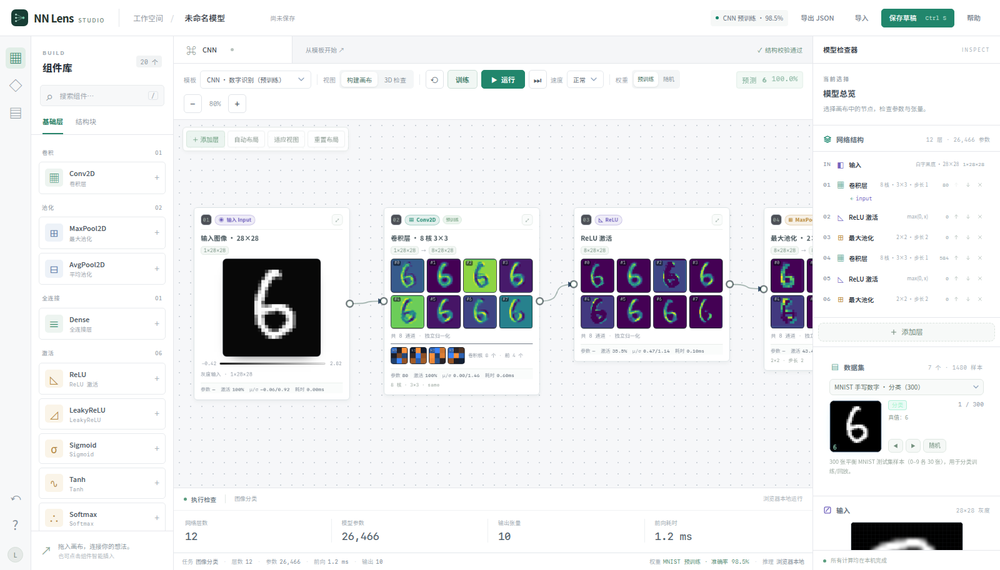
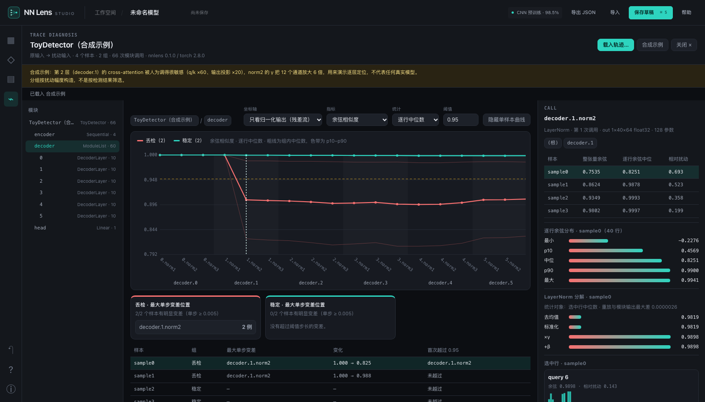
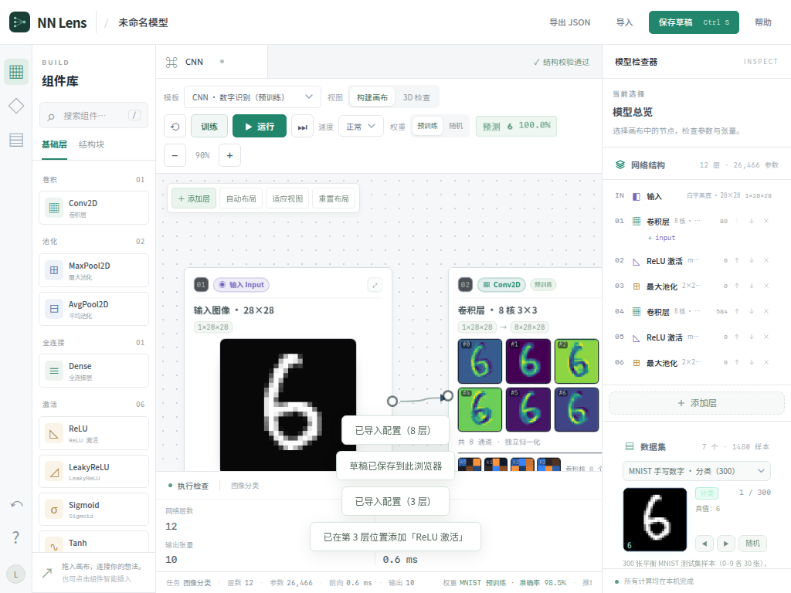

# NN Lens Studio

### 可视化神经网络构建工作台

从组件到模型，在画布上构建、检查与运行神经网络。

**公开成果展示 · 实现源码私有 · 非开源项目**



## 下载

桌面安装包在 [Releases](https://github.com/Air-0000/nn-lens-studio-showcase/releases) 页面发布。当前为 **1.0.0 预发布版**，最新一版是 [v1.0.0-preview.3](https://github.com/Air-0000/nn-lens-studio-showcase/releases/tag/v1.0.0-preview.3)。各平台的验证范围见下文和发布说明。

| 平台 | 文件 | 系统要求 |
| --- | --- | --- |
| macOS（Apple 芯片与 Intel 通用） | `NN-Lens-Studio_1.0.0_macos-universal.dmg` | macOS 12 或更高 |
| Windows x64 | `NN-Lens-Studio_1.0.0_x64-setup.exe` | Windows 10 / 11，需要 Microsoft Edge WebView2 运行时（缺少时安装器会从微软下载） |
| Linux x86_64 | `NN-Lens-Studio_1.0.0_amd64.deb` | Ubuntu 22.04+ / Debian 12+ |
| Linux ARM64 | `NN-Lens-Studio_1.0.0_arm64.deb` | Ubuntu 22.04+ / Debian 12+ |

公开版不含 AIC 多模态检测器的结构摘要和激活快照，模板里的 AIC 入口会提示这一点。其余功能与下文描述一致，全部在本机离线运行，不需要联网。

### 安装

- **macOS**：打开 dmg，把 NN Lens Studio 拖进“应用程序”。安装包为 ad-hoc 签名，未经 Apple 公证。首次打开若被拦截，到“系统设置 → 隐私与安全性”点“仍要打开”。
- **Windows**：运行安装程序，按当前用户安装。安装程序没有 Authenticode 签名，Windows 会提示“未知发布者”。
- **Linux**：`sudo apt install ./NN-Lens-Studio_1.0.0_amd64.deb`（ARM 设备用 arm64 包）。

### 校验文件

每个 release 附带 `SHA256SUMS`。当前清单未做发行者签名，来源以本仓库的 Releases 页面为准。

```bash
shasum -a 256 -c SHA256SUMS --ignore-missing
```

Windows PowerShell：`Get-FileHash .\NN-Lens-Studio_1.0.0_x64-setup.exe -Algorithm SHA256`，与 `SHA256SUMS` 中的值比对。

### 更新记录

- **v1.0.0-preview.3**：新增数据集审计工作区（多模态检测测试集的逐框对撞、人工核验与导出）、逐步演算（推理与单步训练的逐项重放）和 PyTorch 代码导出 / nn-lens-ir 导入；文件拖放改由页面处理。
- **v1.0.0-preview.2**：修复 macOS 上离开“运行轨迹诊断”后构建区可能保持空白的问题；桌面版的“打开合成示例”现在可以载入示例轨迹；视图切换按钮从启动起即以开关按钮提供给辅助功能工具；首次提供 Linux x86_64 包。
- **v1.0.0-preview.1**：首个桌面预发布版（macOS、Windows、Linux ARM64）。

### 已知限制

- 数据集审计在桌面版里通过系统文件夹对话框或把文件夹拖进窗口读取图片；安装包测试只覆盖了打开和关闭这个工作区，还没有在安装包里实际选取或拖入过文件夹。
- Windows 安装包在 Linux 上交叉编译，只做过文件级检查（x64 PE、GUI 子系统、WebView2 加载器、NSIS 结构），尚未在 Windows 实机上安装和启动。
- Linux 包在 Docker 容器的 Xvfb 虚拟显示中安装测试，尚未在实体 Linux 桌面上运行。
- macOS 包只在 macOS 27（Apple 芯片）上测试；通用二进制中的 Intel 部分未在 Intel Mac 上运行。
- 安装包内的前端经过混淆并加密打包，内置小模型的预训练权重加密存储、运行时解密。这些措施提高了直接提取的成本，但离线运行的客户端无法保证不被逆向分析。

## 能做什么

- **搭建模型**：搜索组件、拖入画布、连接端口，创建顺序网络、分支和残差结构。
- **检查参数**：右侧检查器修改层参数，查看输入/输出张量、模型参数量与执行耗时。
- **选择模板**：CNN、MLP、ResNet-lite、Inception-lite、ViT-lite 等预设及基础模型入口。
- **运行与训练**：逐层执行，在当前画布里展示前向激活、反向梯度，并记录和回放训练步骤。桌面版的卷积、全连接、池化和优化器更新由 C 编译的 WebAssembly 执行。
- **处理不同任务**：分类、目标检测与图像分割，支持手写数字和合成图形数据。
- **保存工作**：具名本机草稿、结构与布局 JSON 导入/导出。草稿不包含训练权重。
- **观察结构**：2D 构建与 3D 检查，支持节点拖动、缩放和平移。
- **逐步演算**：在层详情里逐步重放一个输出元素的计算（卷积乘加、全连接、注意力等），以及单步训练中参数梯度的来源和优化器更新；最后一步与引擎结果逐位一致。
- **PyTorch 导出**：把当前模型生成 PyTorch 模型代码、训练脚本和权重文件，以及 nn-lens-ir 中间表示；也可以导入 nn-lens-ir 文件。生成 IR 的 Python 工具目前不公开。
- **数据集审计**：打开本机的多模态检测测试集文件夹（可见光、红外、配准红外、深度、4x 超分），载入多个模型的预测（nn-lens-detset JSON，或每行“类别 cx cy w h 置信度”的提交 zip / txt），把候选模型和基准模型逐框对撞，人工核验分歧框，并导出核验记录、真值补丁和报告。基准只是另一个模型，不当作真值；图片只在本机读取。
- **运行轨迹诊断**：查看同一模型两次前向的逐模块差异（余弦相似度与相对扰动），找出差异从哪一层开始放大。附带一份合成示例轨迹；生成轨迹的 Python 追踪器目前不公开。



## 工作空间

| 区域 | 用途 |
| --- | --- |
| 左侧组件库 | 搜索基础层与结构块，点击或拖拽添加 |
| 中间画布 | 组织节点、连接分支、检查执行结果 |
| 右侧检查器 | 编辑参数、选择数据源、预览输入 |
| 底部概览 | 当前模型层数、参数量、输出张量与执行耗时 |

<details>
<summary>查看紧凑窗口布局</summary>



</details>

## 关于此仓库

此仓库公开项目介绍和界面截图，并在 Releases 中提供桌面安装包。实现源码、离线 HTML 包和数据集不在此分发，源代码仓库继续保持私有。当前没有部署在线应用。

截图展示的是浏览器本地工作台；当前网络输入仍为 28×28 灰度，属于轻量构建和可视化环境，不代表通用大型模型训练平台。安装包不含 Penn-Fudan 行人照片，检测与分割任务使用合成图形；本页不声称行人检测/分割性能。

## 版权与授权

Copyright (c) 2026 [Air-0000](https://github.com/Air-0000).

本项目、展示内容和安装包采用专有权利声明，不授予开源复用许可。除适用法律、GitHub 平台条款或另行书面许可允许的情形外，未经授权不得复制传播受保护内容、换名发布、冒称原创或用于商业产品。具体条款见 [LICENSE](LICENSE)。

公开展示与安装包不能从技术上阻止截图、复制或逆向分析；本仓库通过保留实现源码的私密性，避免公开实现代码。第三方组件与数据的权利仍归原权利人，见 [THIRD_PARTY_NOTICES.md](THIRD_PARTY_NOTICES.md)。

授权或合作请联系 [Air-0000](https://github.com/Air-0000)。
